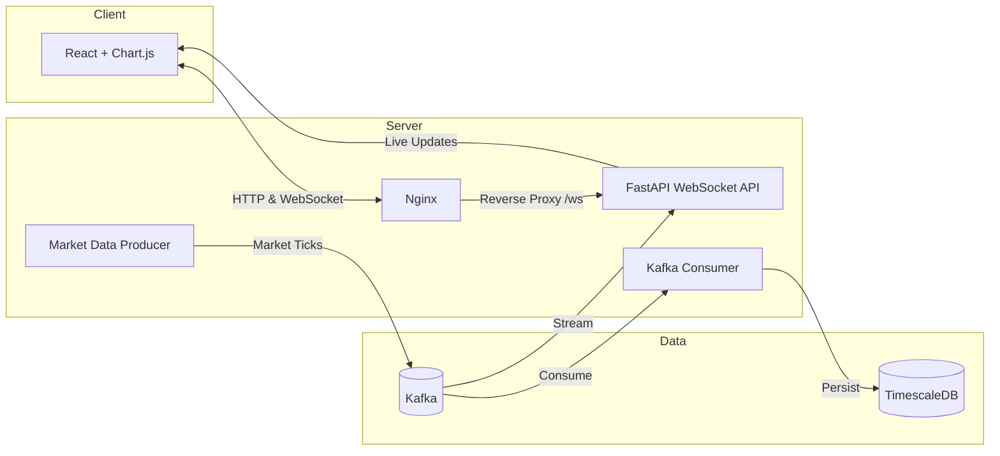
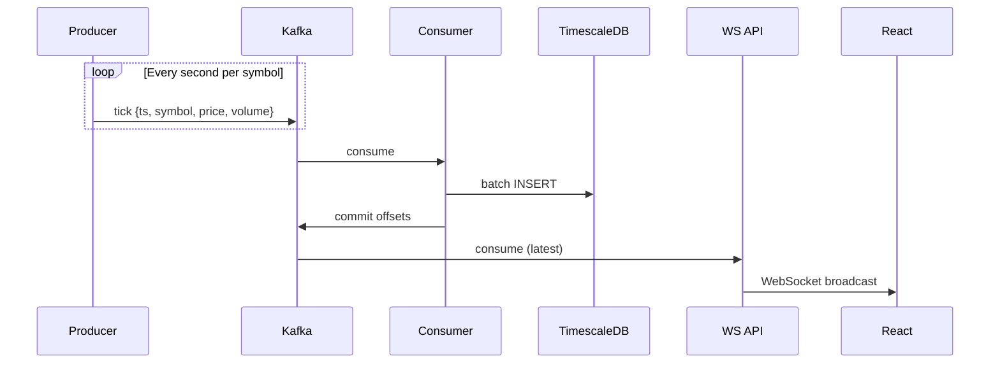
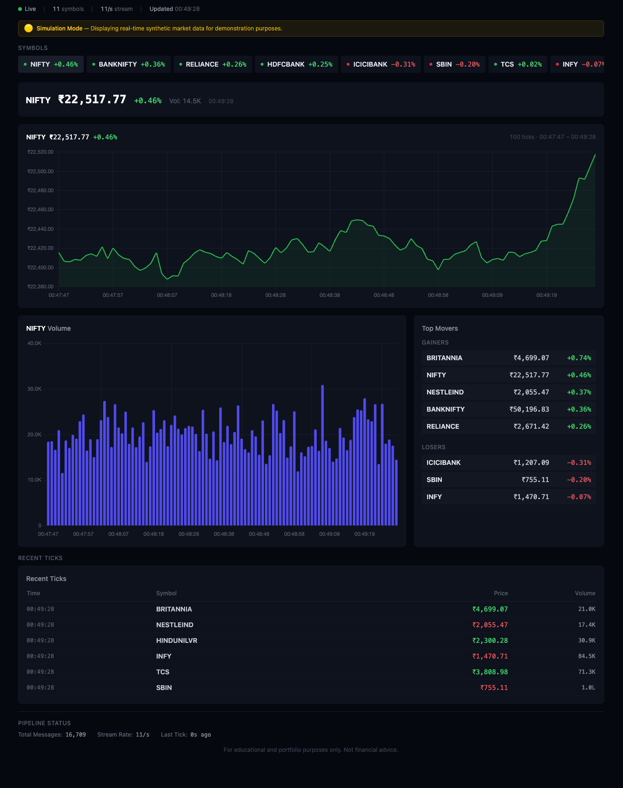
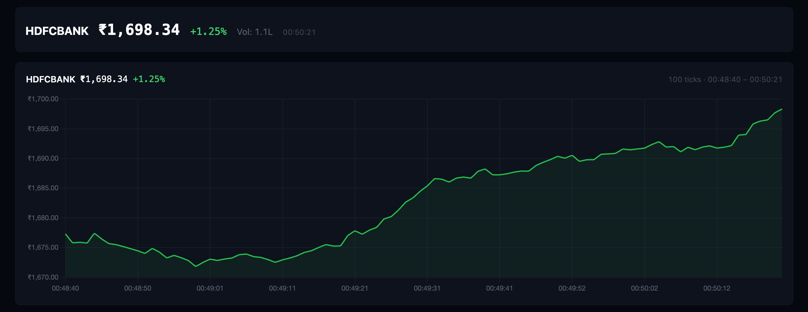

# BullBearSim — Real-Time Market Data Pipeline

[](https://www.python.org)
[](https://kafka.apache.org)
[](https://www.timescale.com)
[](https://react.dev)
[](https://www.typescriptlang.org)
[](https://www.docker.com)

Real-time market data streaming platform. Kafka ingests synthetic stock ticks, TimescaleDB persists them as time-series, a WebSocket API broadcasts to a React + Chart.js dashboard — all running in Docker Compose.
This project demonstrates the complete lifecycle of real-time streaming data—from event generation to storage, broadcast, and visualization.

### Project Highlights

- End-to-end event-driven architecture with Apache Kafka streaming
- Time-series data storage with TimescaleDB hypertables
- Live dashboard powered by WebSocket broadcasting via FastAPI
- Realistic synthetic market simulation (11 instruments, 5 sectors)
- Containerized microservices with Docker Compose and Nginx
- React + TypeScript dashboard for real-time visualization


> **🌐 Live Demo**
[bullbearsim.aniketpalaskar.dev](https://bullbearsim.aniketpalaskar.dev/)

> **📊 Architecture Diagram**
See below

> **🖼️ Dashboard Screenshot**
[images/dashboard-overview.png](images/dashboard-overview.png)

---

## Architecture
    


7 Docker services — `kafka`, `postgres` (TimescaleDB), `app` (producer), `consumer`, `ws_api`, `frontend`, `nginx`.

---

## Data Flow



---

## Why I Built This

To learn event-driven architecture hands-on. Kafka for decoupled streaming, TimescaleDB for time-series storage, WebSockets for live broadcast. The dashboard exists to visualize the pipeline — the pipeline is the point.

---

## Key Features

- **Kafka Streaming** — Decoupled producer and two independent readers: a DB writer (consumer group `db-writer`) and a live WebSocket relay
- **At-least-once Persistence** — Offsets are committed only after a batch is written; `ON CONFLICT DO NOTHING` makes redelivery harmless
- **TimescaleDB** — Hypertable with automatic partitioning and 30-day retention policy
- **WebSocket Broadcast** — FastAPI server fans out ticks to all connected dashboard clients, each with its own send queue so a slow client can't stall the rest
- **Realistic Simulation** — 11 symbols across 5 sectors with mean-reverting prices, smooth market trends and session-based volatility
- **React + Chart.js Dashboard** — Live charts, top movers, symbol strip — all TypeScript
- **Containerized** — 7 services orchestrated via Docker Compose with Nginx reverse proxy

---

## Simulation Overview

11 instruments across 5 sectors (INDEX, BANKING, IT, ENERGY, FMCG), each with a base price and volatility profile. The engine lives in `app/simulation.py`; every second each symbol's log-price moves by:

- **Market factor** — noise shared by all symbols plus a trend drift. `TrendEngine` switches between bullish, neutral and bearish phases (~10 minutes each), and the drift eases toward each new phase instead of jumping.
- **Sector factor** — noise shared within a sector, so banks move together, IT moves together, etc.
- **Idiosyncratic noise** — per-symbol volatility.
- **Mean reversion** — a gentle pull back toward the base price (Ornstein–Uhlenbeck), so prices wander realistically but never run away. A hard safety band caps the deviation at roughly −26% / +35%.

Session multipliers (IST trading hours: opening, lunch lull, closing rush, after-hours, weekends) scale volatility and volume through the day. Calibrated so indices move ~1–1.5% per session and stay within a few percent of base over weeks; `tests/test_simulation.py` checks these bounds. No external APIs required — the engine runs entirely within Docker.

---

## Simulation Notice

BullBearSim uses a realistic market simulation engine to generate synthetic stock prices and trading volumes.

The dashboard does **not** display live market data, and none of the information should be interpreted as real financial information or investment advice.

The simulator runs continuously so the live demo always has fresh streaming data.

---

## Technology Stack

| Layer | Technology |
|-------|-----------|
| Streaming | Apache Kafka 3.5 via Confluent Platform 7.5 image (single-node, KRaft mode) |
| Storage | TimescaleDB (PostgreSQL 14 + hypertables) |
| Producer | Python 3.11, aiokafka, asyncio |
| Consumer | Python 3.11, aiokafka, psycopg2 |
| WebSocket API | Python 3.11, FastAPI, aiokafka |
| Frontend | React 18, TypeScript, Chart.js, TailwindCSS, Vite |
| Infrastructure | Docker Compose, Nginx |

---

## Demo

[BullBearSim Demo Video](https://github.com/user-attachments/assets/6d7332e4-d572-4df9-beb9-4608bd347e98)

## Screenshots

| Overview | Price Chart |
|----------|-------------|
|  |  |

---

## Getting Started

```bash
git clone https://github.com/ATmax1425/BullBearSim.git
cd BullBearSim

cp .env.example .env
```

Edit `.env`:

- `POSTGRES_PASSWORD` — any strong password (e.g. `openssl rand -base64 24`).
- `KAFKA_CLUSTER_ID` — a KRaft cluster ID, generated with:

  ```bash
  docker run --rm confluentinc/cp-kafka:7.5.0 kafka-storage random-uuid
  ```

  Keep it unchanged once Kafka has stored data in the `kafka-data` volume.

### Choose the appropriate Nginx configuration

The repository contains two Nginx configurations:

- **Production (`nginx.conf`)** – HTTPS, SSL certificates, Cloudflare-compatible.
- **Development (`dev/nginx_local.conf`)** – HTTP only, intended for local development with Vite.

The repository defaults to the **production configuration**. It serves HTTPS only (port 80 drops connections) and expects a certificate in `./certs/`:

```
certs/fullchain.pem
certs/privkey.pem
```

(For Cloudflare, use a Cloudflare Origin Certificate.) Without these files nginx will not start.

If you're running locally without SSL, update `docker-compose.yml`:

```yaml
# Production
# - ./nginx.conf:/etc/nginx/nginx.conf:ro

# Local development
- ./dev/nginx_local.conf:/etc/nginx/nginx.conf:ro
```

Then start the stack:

```bash
docker compose up -d --build
```

Verify:

```bash
docker compose ps
curl http://localhost/ws/health     # https://… with the production config
```

Open:

```
http://localhost
```

The simulator publishes **11 ticks/second** (one per symbol). `/ws/health` returns `200` with `"status": "ok"` while ticks are flowing, and `503` if ws_api has lost Kafka or no tick has arrived for 15 seconds.

All services restart automatically (`restart: unless-stopped`) and container logs are rotated (3 × 10 MB per service).

---

## Local Development (Frontend)

Requires the full backend stack (`docker compose up`) running with the local nginx config (see Getting Started).

```bash
cd frontend && npm install && npm run dev
```

Vite proxies `/ws` to the Docker stack on `localhost:80`.

---

## Historical Data Backfill

Postgres is only reachable on the internal Docker network, so the backfill script runs inside the consumer image. It uses the same simulation engine and symbols as the live producer and writes ticks for IST market hours on weekdays:

```bash
docker compose run --rm -v "$PWD:/repo" -w /repo consumer \
    python dev/generate_historical_data.py --days 7 --step 60
```

Re-running is safe; existing `(ts, symbol)` rows are skipped. Data older than 30 days is removed by the retention policy.

---

## Tests

```bash
pip install -r app/requirements.txt -r consumer/requirements.txt -r ws_api/requirements.txt pytest
pytest tests

cd frontend && npm ci && npm run build   # type-check + build
```

GitHub Actions (`.github/workflows/ci.yml`) runs both, plus a `docker compose config` check, on every push to `main` and on pull requests.

---

## Project Structure

```
├── app/                  Tick producer (app.py) + simulation engine (simulation.py)
├── consumer/             Kafka consumer → TimescaleDB writer (Python)
├── ws_api/               WebSocket broadcast API (FastAPI)
├── frontend/             React + TypeScript dashboard (Vite)
├── dev/                  Historical data backfill + local nginx config
├── tests/                Python tests (simulation, consumer, ws_api)
├── images/               README screenshots
├── .github/workflows/    CI
├── nginx.conf            Production reverse proxy config
├── docker-compose.yml    All 7 services defined here
├── .env.example          Environment variables template
└── init.sql              TimescaleDB schema + retention policy
```

---

## Engineering Decisions

**Why Kafka?** Decouples producer from consumers. Both the DB writer and WebSocket API read the same topic independently. Enables replay and future consumer additions.  
**Why TimescaleDB?** Hypertables provide automatic time-based partitioning, efficient range queries, and built-in retention — all in standard PostgreSQL. Today the database is the durable history of the stream; serving it back (history API, replay) is on the roadmap.  
**Why WebSockets?** Push-based broadcast suits live financial data. Polling adds latency. FastAPI + asyncio handles hundreds of concurrent clients.  
**Why Synthetic Data?** Self-contained — no API keys or external dependencies. Trend phases, sector noise and mean reversion produce realistic price action.  
**Why React over Grafana?** Full control over the visualization layer, native WebSocket integration, and version-controlled dashboard code.

---

## Engineering Challenges

**Docker Networking**. Internal network isolates backend services; Nginx bridges to the public. Required careful `depends_on` configuration for startup ordering.  
**Nginx WebSocket Proxying**. WebSocket upgrades need specific headers. Initial config proxied `/ws` to the wrong upstream — fixed by understanding `$http_upgrade` semantics.  
**Grafana → React Migration**. Original dashboard used Grafana + PostgreSQL. Migrated incrementally: proved WebSocket broadcast worked, then replaced panels one by one.  
**Simulation Engine Design**. Early ticks were random walks. TrendEngine adds persistent market phases with smooth transitions and sector factors create correlated noise. A pure random walk with per-second drift also compounds: left running for days, prices drifted 10× from their base. Mean reversion toward the base price and per-second calibration (validated by simulating 30 days in tests) keep the long-running demo realistic.

---

## Lessons Learned

- Kafka lets independent readers consume the same topic. The DB writer uses a consumer group and commits offsets only after writing, so restarts resume without losing ticks; the WS relay uses no group and always starts from the latest offset, so a restart never replays stale ticks to the browser.
- WebSocket reconnection with exponential backoff (1s → 30s) handles transient failures without flooding the server.
- A fixed 100-tick buffer keeps the chart window stable. Computing change from the first visible tick keeps the UI consistent.
- TailwindCSS dark palette (`gray-950`/`gray-900`/`gray-800`) produces a professional look with minimal CSS.

---

## Project Evolution

**Phase 1** — Kafka + TimescaleDB + Grafana. Proved the pipeline concept.  
**Phase 2** — FastAPI WebSocket server + custom React + Chart.js dashboard. Migrated away from Grafana incrementally.  
**Phase 3** — Redesigned simulation engine (11 symbols, 5 sectors, TrendEngine). Polished the dashboard. This README.

---

## Future Roadmap

- **Historical Replay** — Replay past ticks from TimescaleDB at configurable speed
- **Provider Abstraction** — Swap the synthetic producer with real market data APIs
- **Cloud Deployment** — Terraform scripts for ECS/K8s with managed Kafka and TimescaleDB

---

## Deployment

| Target | Status |
|--------|--------|
| Docker Compose | Complete |
| Nginx reverse proxy | Complete |
| Cloud (AWS) | Live — [bullbearsim.aniketpalaskar.dev](https://bullbearsim.aniketpalaskar.dev/) |
| DNS (Cloudflare) | Live |

The production nginx configuration (`nginx.conf`) includes SSL termination and Cloudflare headers. Terraform modules for ECS deployment are part of the Future Roadmap.

---

## License

MIT
